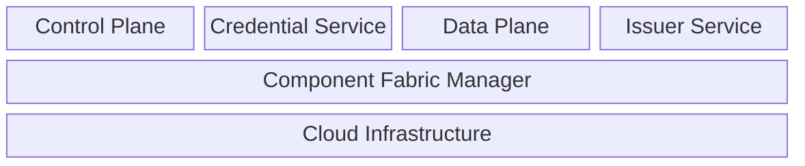
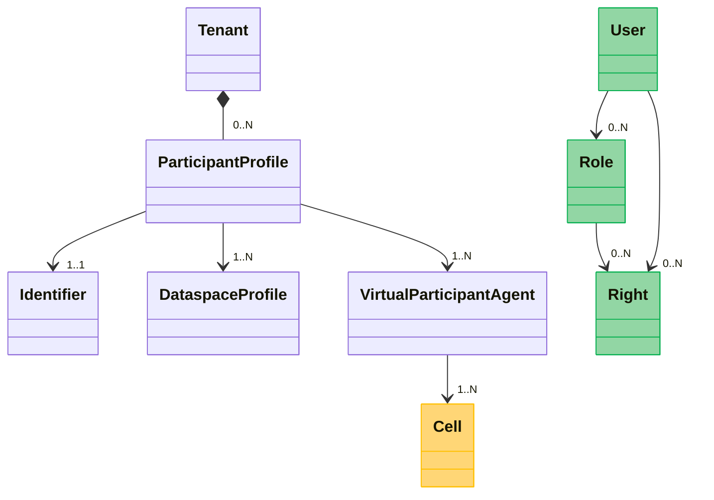
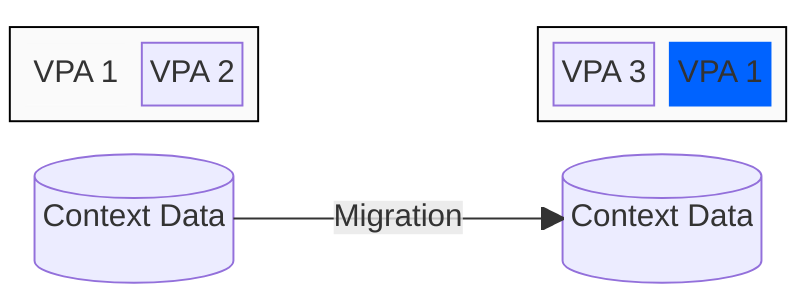

# Service Virtualization

This document describes the service virtualization model of the dataspace variant of the Component Fabric Manager
(CFM). It was part of the system architecture document of [eclipse-cfm/cfm](https://github.com/eclipse-cfm/cfm) before
the dataspace components moved to this repository. The generic engine that the model is implemented on is described in
the [CFM system architecture](https://github.com/eclipse-cfm/cfm/blob/main/docs/developer/architecture/system.architecture.md).

## Introduction

CFM-Dataspace deploys and manages dataspace-related (connector) resources in a multitenant environment. These resources
include:

- A Control Plane, which manages data sharing operations (including catalog publication, contract
  negotiation, and transfer control)
- One or more Data Planes that perform data transmission
- A Credential Service that manages a participant's DID artifacts, store credentials, and create Verifiable
  Presentations
- An Issuer Service for entities and participants that issue Verifiable Credentials.

Dataspace services do not operate in isolation. They collaborate with cloud services (for example, a vault for secure
storage and load-balancers for network routing) and other networking infrastructure. The CFM orchestrates these layers
and provides the isolation necessary for efficient and secure multitenant operation:

**Logical Systems Architecture**

The dataspace variant consists of the following subsystems:

- The **Tenant Manager (TM)** (`tmanager`) which manages tenancy data and initiates deployment processes. It is a
  manager of the CFM engine, in the namespace `default`.
- The **Provision Manager (PM)** of [eclipse-cfm/cfm](https://github.com/eclipse-cfm/cfm) which executes stateful
  orchestrations that configure services and infrastructure for participants.
- **Activity Agents** (`agent/orchestration`) that execute tasks specified by the Provision Manager, and **Lifecycle
  Agents** (`agent/lifecycle`) that react to events of the dataspace services.

## Multitenancy and Service Virtualization

The system architecture is based on the concept of ***service virtualization***: a single software deployment can enable
an isolation environment to process requests for different participants and dataspace contexts. We use the term
virtualization over multitenancy for several reasons. First, multitenancy is too ambiguous and has been used to denote
different architectures. More importantly, multitenancy does not accurately describe the architecture this document lays
out. As we will see, while individual services have the concept of an isolation context, it does not directly map to the
concept of a "tenant." Instead, tenant management is externalized from core dataspace services and managed by the CFM.

## Service Virtualization Model

Service virtualization is based on the following model:

**Virtualization Model**

A **Tenant** represents an organization or entity that participates in one or more dataspaces. A tenant has one or more
**Participant Profiles.** Each profile is associated with an **Identifier**, at least one **Dataspace Profile**, and at
least one **Virtual Participant Agent (VPA)**.

A Dataspace Profile includes a set of interoperable policies and DSP protocol version.

A Virtual Participant Agent is a unit of administrative control and deployment. A VPA targets a **cell**.

A **User** performs management operations against a VPA using an RBAC model based on **roles** and **rights**.

The service virtualization layers in the control plane and data plane implement runtime isolation for each VPA.
Importantly, they do not contain the concept of a tenant; the CFM orchestrator manages tenants.

The control and data planes use the VPA as the unit of runtime isolation. However, the services are loosely coupled
through the [Data Plane Signaling Protocol](). As will be detailed later, control plane and data plane deployments are
typically remote and mapped by participant profile.

#### The Participant Profile

A dataspace has an overriding constraint:

> A participant has one and only one identifier

Note that this does not mean an organization (e.g., a legal entity) must have exactly one identifier. Rather, if an
organization has multiple identifiers, it must either be mapped to a single identity (e.g., DID) or the organization
must have multiple participants.

Let's break down several different virtualization scenarios based on this using a fictitious organization, Acme
Industries.

##### One identity per dataspace

In this scenario, Acme uses one DID per dataspace. This results in a participant profile per dataspace since the
identifiers used for each dataspace are different.

##### One identity, multiple dataspaces

In this scenario, Acme uses a single DID across multiple dataspaces, resulting in a single participant profile for all
dataspaces.

#### Virtual Participant Agents

A VPA defines a runtime context deployed when a participant profile is provisioned. Let's consider a simple case where
Acme participates in one dataspace. Returning to the logical systems architecture, VPAs for the control plane,
credential service, and data plane(s) will be provisioned. This results in the creation of three VPA *types*:

- A Credential Service VPA
- A Control Plane VPA
- A Data Plane VPA

Multiple VPAs of the same type may also be deployed. For example, Acme may want to share streaming data and access to an
API, which are served through different data planes. In this case, two VPAs will be created, one for each data plane.

VPAs are linked through network, transport, and application security layers. As will be detailed further, a control
plane and data plane VPA may rely on a VPN, TLS, and OAuth tokens for secure communications.

##### Cell Targeting

VPAs are targeted to a *cell*, which is a homogenous deployment zone. A cell could be a Kubernetes cluster or some other
infrastructure. Cells are responsible for their own scaling. For example, a Kubernetes-based cell may use an autoscaling
system such as [Keda](https://keda.sh/) to add capacity dynamically.

##### RBAC: Users, Roles, and Rights

> TODO: This section will be further developed as requirements evolve.

A **User** represents an administrator who can perform a set of actions against subsystems. Users have a set of **Rights
** and/or are assigned **Roles**.

## Context Isolation Architecture

The virtualization model we have outlined is realized across multiple services through runtime context isolation. A
guiding principle is that this isolation is ***configuration-based***, not _**process-based**_. A process-based
architecture achieves isolation based on runtime segmentation. For example, a VPA following this approach would spin up
a set of operating system processes such as control plane, data plane, and database instances. This is not scalable or
efficient. Instead, a configuration-based isolation architecture involves writing VPA metadata to a persistent store.
This metadata is used by shared services that create inexpensive isolation contexts on the fly when requests are
received and processed. This provides efficient service utilization and makes context migration relatively easily - move
the VPA metadata to a different cell and update request routing configuration.

**Configuration-Based Architecture**

To implement this architecture, each service provides APIs for creating, updating, and deleting VPA metadata.

## Tenant Manager

The Tenant Manager implements the service virtualization model and provides a REST API for executing operations that
modify resources. Virtualization model entities are persisted with extensible properties that can be queried using the
CFM predicate-based query language.

When the Tenant Manager provisions or disposes resources, it sends orchestration manifests to the Provision Manager,
which asynchronously notifies the Tenant Manager when processing is completed. The VPAs of a participant profile are
deployed with the orchestration type `cfm.orchestration.vpa.deploy` and disposed with
`cfm.orchestration.vpa.dispose`; both are defined in the `dataspace` package.
